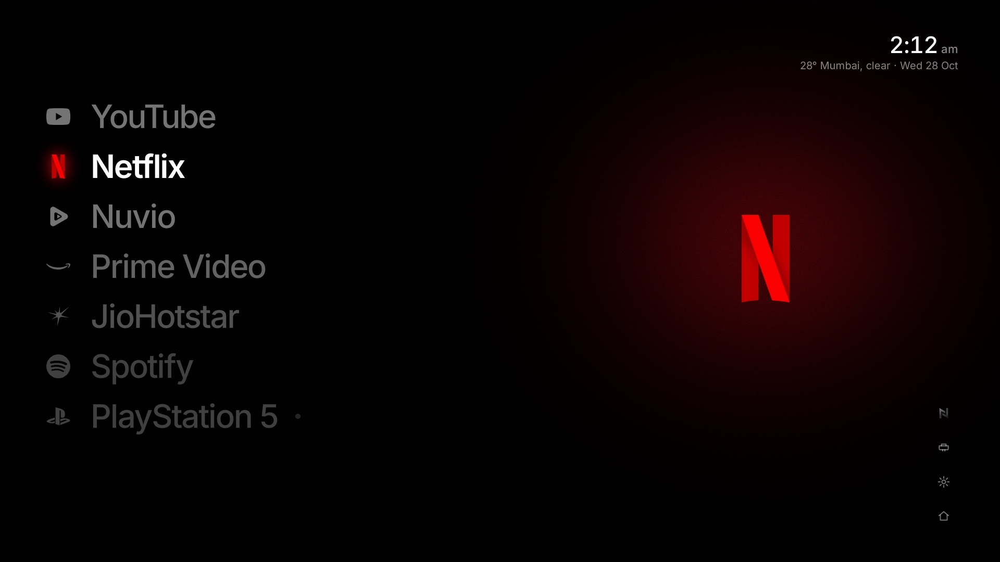

<p align="center"></p>

# Nox

A quiet home screen for LG OLED TVs. True black, one list of your apps and inputs, the focused one lit in its own colour, and a clock when you stop touching the remote. No root needed: it installs through LG's Developer Mode.



> **Reference device:** LG OLED65G6PLA (2026 G6), webOS 11.2 (Chromium 132), not rooted. Other LG TVs on recent webOS should work but are untested. Reports are welcome in [Issues](https://github.com/vrarora/nox/issues).

> **Using an AI agent?** Point it at [AGENTS.md](AGENTS.md). It has the full install and customisation runbook, with a check after every step and the steps that need you in person marked.

## What it does

- **One list.** Your streaming apps and HDMI inputs, in your order. The focused row shows the app's logo in its own colours, with a soft glow of that colour behind the preview.
- **Live inputs.** HDMI rows show whether the device is on, so a PS5 row says "Off" or lights up when the console wakes.
- **Continue watching (optional).** If you use [Nuvio](https://nuvio.tv), the Nuvio row previews what you were watching, and OK opens it straight to that title.
- **Ambient mode.** After 30 seconds without input, everything but the clock and weather fades away, and the screen shifts a few pixels every minute to spare the OLED.
- **Fast.** First paint is around 340 ms, and the TV keeps Nox in memory, so coming back from an app is instant.
- **Yours to arrange.** Hold OK on a row to move it. A settings screen hides apps and changes the ambient delay and sounds.

## What an unrooted TV allows

| Works | Does not work (webOS blocks it for sideloaded apps) |
|---|---|
| Launch any installed app or HDMI input | Opening Nox with the remote's Home button |
| Read HDMI input states | Listing installed apps (Nox uses a fixed list and hides the ones not installed) |
| Clock in the TV's 12/24 h format, toasts, volume | Turning the screen or TV off |

Open Nox from its tile in LG Home. Pin the tile first in the row so Home → Nox is one press.

## Install

### With an AI agent

Give your agent (Claude Code, Codex, Cursor and so on) this prompt, from a computer on the same network as the TV:

```text
Install Nox on my LG TV by following AGENTS.md in https://github.com/vrarora/nox.
Ask me before any step that needs me at the TV, and before changing app list or weather city.
```

### By hand

You need a computer with [Node.js](https://nodejs.org) 20 or newer, the TV and the computer on the same network, and a free LG developer account.

1. **Turn on Developer Mode on the TV.**
   1. Create an account at [webostv.developer.lge.com](https://webostv.developer.lge.com).
   2. On the TV, install **Developer Mode** from the LG Content Store and sign in with that account.
   3. Turn **Dev Mode Status** on and let the TV restart.
   4. Open Developer Mode again, turn **Key Server** on, and note the **IP address** and the **passphrase** it shows.
2. **Connect the computer to the TV.**
   ```bash
   git clone https://github.com/vrarora/nox.git
   cd nox
   npm install
   npx ares-setup-device -a lgtv -i "host=<TV IP>" -i "port=9922" -i "username=prisoner"
   npx ares-novacom --device lgtv --getkey      # asks for the passphrase from step 1
   npx ares-device -i -d lgtv                   # prints the TV's model and webOS version
   ```
3. **Install Nox.** Either build it from source, which lets you change the app list and weather city first (see [Make it yours](#make-it-yours)):
   ```bash
   npm run tv                                   # build, package, install and launch
   ```
   or install the prebuilt package from [Releases](https://github.com/vrarora/nox/releases):
   ```bash
   npx ares-install -d lgtv app.nox.launcher_0.2.0_all.ipk
   ```
   The prebuilt package uses the default app list and shows Mumbai weather.
4. **Keep Developer Mode alive.** LG's Developer Mode session expires after about 50 hours. Open the Developer Mode app and press **Extend** before it runs out, or the TV removes every sideloaded app, Nox included.

To remove Nox: `npx ares-install -d lgtv -r app.nox.launcher`.

## Make it yours

All of this is in the source, so it needs a rebuild (`npm run tv`).

| What | Where |
|---|---|
| Which apps and inputs appear, their titles, colours and app ids | `src/catalogue.ts`. Apps that aren't installed hide themselves. HDMI inputs are apps named `com.webos.app.hdmi1` to `hdmi4`. |
| Weather city | `PLACE` in `src/hooks/useWeather.ts` (name, latitude, longitude, time zone) |
| Logos | `src/components/Glyph.tsx`, one square SVG per catalogue key |
| Order, hidden apps, ambient delay, sounds | On the TV in Nox's settings, or from the computer with `node scripts/config.mjs push my-config.json` (format: [config.example.json](config.example.json)) |

## Using it

| Remote key | On the home screen |
|---|---|
| Up / Down | Move through the list |
| Right / Left | Jump to the utility column (Nox settings, inputs, TV settings, LG Home) and back |
| OK | Open the app or switch to the input |
| Hold OK | Lift the row to move it. Up/Down move it, OK places it, Back cancels |
| Back | Returns from Nox's settings |

The first key press after ambient mode only wakes the screen.

## Nuvio (optional, unofficial)

Nox reads your Nuvio continue-watching list with its own device login: focus the Nuvio row and scan the QR code with a phone signed in to Nuvio. This uses Nuvio's public API in the same way its own apps do. **It is not affiliated with or endorsed by Nuvio** and may stop working if their API changes.

Opening a title directly also needs a small patch to the Nuvio TV app, in `scripts/nuvio/`. It is optional and advanced: it pulls the installed Nuvio app over SSH, adds a launch-parameter handler, and reinstalls it. Instructions are in the header of `scripts/nuvio/patch.mjs`. Without the patch, OK on the Nuvio row simply opens Nuvio.

## Troubleshooting

| Problem | Fix |
|---|---|
| `ares-novacom --getkey` fails | Key Server must be on in the Developer Mode app, and the passphrase is case-sensitive. |
| LG Home shows a blank tile after an update | LG Home caches tile icons by file name. Turn the TV fully off at the wall for 30 s, or ship the icon under a new file name (see `brand/nox-icon/README.md`). |
| Nox and other sideloaded apps disappeared | The Developer Mode session expired. Turn Dev Mode on again, then reinstall. |
| An app is missing from the list | Its id in `src/catalogue.ts` doesn't match the TV. Check with `node scripts/shot.mjs out.png "<expression>"` (see AGENTS.md) and fix the id. |
| Weather shows the wrong city | Change `PLACE` in `src/hooks/useWeather.ts` and rebuild. |

## Develop

```bash
npm install
npm run dev          # Vite dev server on the computer; every app shows because there is no TV to ask
npm run build        # type-check and bundle to dist/
npm run tv           # build, package, install and launch on the TV named "lgtv" (TV_DEVICE to change)
```

| Script | Does |
|---|---|
| `npm run package` | Build and make `build/app.nox.launcher_<version>_all.ipk` |
| `npm run measure -- 3` | Launch three times and print cold-start timings from the TV |
| `node scripts/shot.mjs out.png [js]` | Screenshot the running app over DevTools, optionally evaluating JavaScript in it first |
| `node scripts/config.mjs pull` / `push <file>` | Read or replace the settings saved on the TV |
| `node scripts/export-icon.mjs` | Re-render the icon PNGs and splash from `brand/nox-icon/svg/nox-icon-master.svg` |

Preact, TypeScript and plain CSS, bundled by Vite into one classic script so it runs from `file://` on the TV. [AGENTS.md](AGENTS.md) has the code map and conventions, and `docs/` has the original brief, plan and platform research.

## Credits

- Built with [Preact](https://preactjs.com), [Vite](https://vitejs.dev) and the [Inter](https://rsms.me/inter/) typeface.
- Weather from [Open-Meteo](https://open-meteo.com) (CC BY 4.0). Artwork for continue-watching from Cinemeta.
- Ideas and platform findings from the community launchers [Hearth](https://github.com/rudra-avatar/Hearth), [Lumen](https://github.com/samrenfrew/lumen-webos), [Lightkeeper](https://github.com/chiotas/lightkeeper) and [GlassHouse](https://github.com/rorygallagher2024/glasshouse).
- App logos are trademarks of their owners and are used only to identify the apps. Full list in [THIRD_PARTY_NOTICES.md](THIRD_PARTY_NOTICES.md).

## Licence

[MIT](LICENSE). Nox is an independent project, not affiliated with LG Electronics or with any app it launches.
